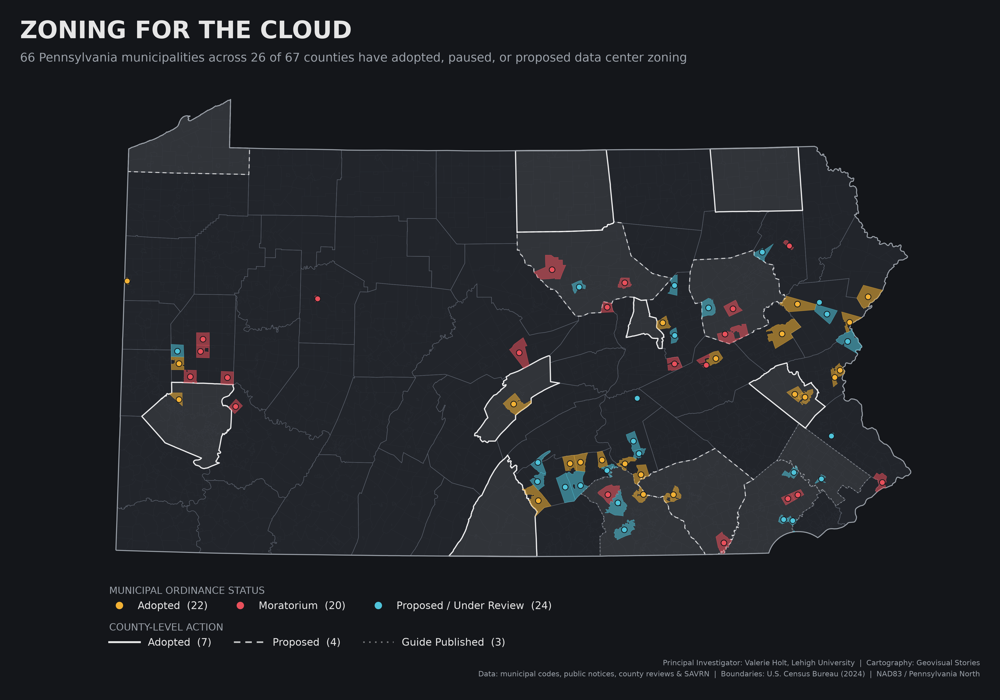

# Zoning for the Cloud: Pennsylvania's Data Center Ordinances

Principal Investigator: Valerie Holt, Teaching Associate Professor and NSF NRT Director of Operations for SEED EF, P.C. Rossin College of Engineering and Applied Science, Lehigh University<br>
Cartography & analysis: Geovisual Stories

<picture>
  <source media="(prefers-color-scheme: dark)" srcset="outputs/pa_datacenter_zoning_both_dark.png">
  <source media="(prefers-color-scheme: light)" srcset="outputs/pa_datacenter_zoning_both_light.png">
  
</picture>

**WHO** — Local governments in Pennsylvania deciding where data centers can be built:<br>
66 towns and townships in 26 of the state's 67 counties, plus 14 county governments

**WHAT** — Local zoning response to data center development: adopted ordinances/overlays, moratoria, and proposed or draft amendments

**WHERE** — Statewide, municipal-scale; concentrations in the Harrisburg/Cumberland Valley, Lehigh Valley, Poconos, and Butler County

**WHEN** — Actions dated 2025–2026 (compiled October 2026)

**WHY** — Data center siting is being decided township by township. This map shows where local governments have moved first, and how unevenly.

🗺️ **[Explore the interactive map →](https://geovisualstories.github.io/pa-datacenter-zoning/)**

## Quick start
```bash
python -m venv .venv
.venv\Scripts\activate          # Windows
pip install -r requirements.txt
python make_maps.py             # downloads Census boundaries on first run
```

### Options
| Flag | Effect |
|---|---|
| `--style polygons\|points\|both` | Fill municipal polygons, draw points, or both (default) |
| `--no-counties` | Hide county boundaries |
| `--no-county-ordinances` | Hide the dashed wash for county-level ordinances |
| `--label-counties` | Label counties with municipal activity |
| `--all-variants` | Export every style × county-boundary combination |

## Method
- **Status categories:** free-text status collapsed by precedence: *Adopted* > *Moratorium* > *Proposed / Under Review* (includes drafts, curative-amendment processes, county reviews).
- **Geometry:** U.S. Census cartographic boundary files (county subdivisions = PA municipalities), 2024.
- **Matching:** county + municipal name + type. Results in `data/processed/match_report.csv`.
- **Projection:** NAD83 / Pennsylvania North (EPSG:32128).
- **GIS-ready output:** `data/processed/pa_datacenter_ordinances.gpkg` opens directly in ArcGIS Pro.

## Data sources
Ordinance research led by Valerie Holt (Principal Investigator, Lehigh University). Status compiled from municipal codes, public hearing notices, county planning reviews, Protect Our Poconos, Protect Cumberland County, and SAVRN. Boundaries: U.S. Census Bureau. Relief: USGS 3D Elevation Program (~90 m, fetched on first run). Typeface: Barlow Condensed (SIL Open Font License, `fonts/OFL.txt`).

*Ordinance landscape changes weekly; this is a snapshot.*
